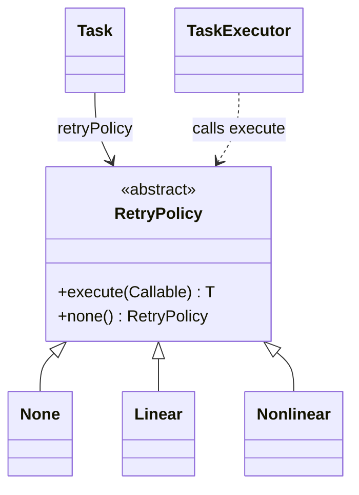

<!-- ILLUSTRATIVE (stage 1 guide, 2026-10-08): the shape of an LLM-written page. The claims were checked by hand
against the code at commit ef0d2c9; the sha256 values are the first 16 hex digits of the hash of the cited lines. -->

# Retry policies

Every task carries exactly one retry policy. If the task's builder is not given one, the task gets
`RetryPolicy.none()`, which runs the action once and never retries.[^task-default][^rp-none] A
policy is attached with `Task.Builder.retryPolicy(...)`.[^task-setter]

## The three policies

| Policy                                           | Attempts               | Wait between attempts             | Retries when                      |
|--------------------------------------------------|------------------------|-----------------------------------|-----------------------------------|
| `None`                                           | 1                      | none                              | never                             |
| `Linear(maxRetries, interval, condition)`        | up to `maxRetries + 1` | the same `interval` each time     | `condition` accepts the exception |
| `Nonlinear(maxRetries, baseInterval, condition)` | up to `maxRetries + 1` | `baseInterval` × 1, 2, 3, 5, 8, … | `condition` accepts the exception |

- `Linear` loops from attempt 0 to `maxRetries`, stops early when the condition rejects the
  exception, and rethrows the last exception when it gives up.[^rp-linear]
- `Nonlinear` uses the same loop but advances a Fibonacci pair before each sleep, so the multipliers
  are 1, 2, 3, 5, 8 and so on.[^rp-nonlinear]

*Diagram generated from the analyzer's type graph (inheritance, fields, resolved calls), not drawn
by the LLM.*

## Where the executor applies it

`TaskExecutor.executeTask` runs `task.retryPolicy().execute(task.action())`. On success it records
the result and calls the task's `onSuccess`; on failure it hands over to
`handleFailure`.[^te-execute-task] `handleFailure` runs the task's fallback if there is one. If
there is no fallback, or the fallback also fails, it records the failure and calls `onFailure`; it
rethrows only when fail-fast is on.[^te-handle-failure] So the order is: all retries first, then the
fallback.

## Adding your own policy

Subclass `RetryPolicy`, implement `<T> T execute(Callable<T> action)`, and pass an instance to
`Task.Builder.retryPolicy(...)`.[^rp-execute][^task-setter] The constructor is `protected`, so a
subclass must call
`super(maxRetries, baseInterval, condition)`.[^rp-facts]

## Where the documentation disagrees

The README's retry example uses `.retry(RetryPolicy.linear(3, Duration.ofSeconds(1)))`. The builder
method is
`retryPolicy`, and there is no `linear` factory.[^readme-retry-example][^task-setter][^rp-facts] The
[README's document page](../docs/readme.md) lists every disagreement.

> Synthesis: `Nonlinear` keeps its Fibonacci position in two instance fields that are never reset,
> so one instance
> shared by several tasks or runs would keep lengthening its delays. Use a new instance per task.
> (Inferred from the
> code; not tested.)

[^rp-facts]: RetryPolicy (code facts)
[^rp-none]: RetryPolicy.java L57-L66
[^rp-linear]: RetryPolicy.java L71-L96
[^rp-nonlinear]: RetryPolicy.java L101-L130
[^rp-execute]: RetryPolicy.java L39
[^task-default]: Task.java L44
[^task-setter]: Task.java L71-L74
[^te-execute-task]: TaskExecutor.java L215-L228
[^te-handle-failure]: TaskExecutor.java L239-L258
[^readme-retry-example]: README.md L91
